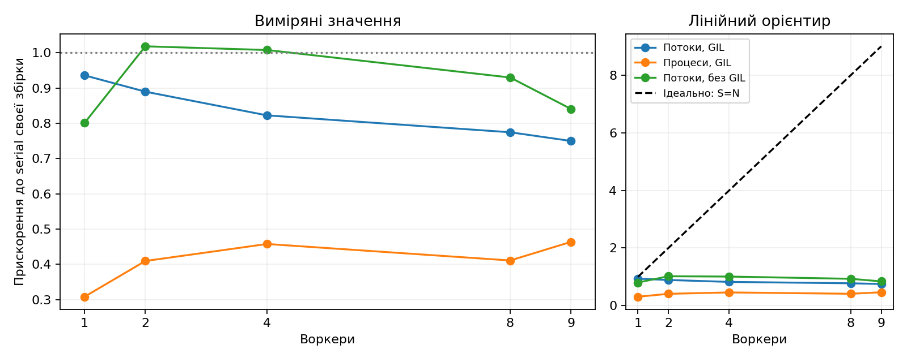

# findex · Лабораторна №1

**Публічна адреса:** [https://findex-web.onrender.com](https://findex-web.onrender.com)

[](https://github.com/d0ntfallasleep/findex/actions/workflows/ci.yml)

Перший крок до пошукової системи на Python. Програма проходить папку з текстами, рахує слова і виводить 50 найчастіших разом з кількістю входжень.

## Корпус

Для першої роботи я взяв англійський текст «Війни світів» Герберта Веллса. Один документ — один розділ. У першій частині їх 17, у другій — 10. Залишив назви розділів і сам текст. Зміст та службові сторінки видання у статистику не потрапляють. Корпус можна розширити, додавши інші книги у вигляді UTF-8 файлів з розширенням `.txt` до папки `data/`.

Джерело — [Project Gutenberg, книга №36](https://www.gutenberg.org/ebooks/36). Скрипт завантажує [фіксовану копію видання](https://github.com/GITenberg/The-War-of-the-Worlds_36/blob/8b08fa3a7cbef117c80b2b437adc46e75c37dbf0/36-0.txt) і розкладає розділи у `data/war-of-the-worlds/`. Папка `data/` додана в `.gitignore`.

## Запуск

Потрібен `uv`. На Mac його можна встановити командою `brew install uv`, якщо є Homebrew. Усі команди нижче виконуються з папки проєкту.

```bash
uv sync --locked
uv run python scripts/prepare_data.py
uv run python -m findex.stats data/
```

Щоб перевірити тільки три документи або запустити версію зі списками на всій книзі:

```bash
uv run python -m findex.stats data/ --limit 3
uv run python -m findex.stats data/ --eager
```

## Як рахуються слова

`iter_documents()` обходить вкладені папки та видає через `yield` по одному документу. Ідентифікатор — шлях відносно папки корпусу. Якщо файл не читається як UTF-8, програма виводить попередження й переходить до наступного.

`tokenize()` застосовує NFC, щоб обидва записи літери `é` дали однаковий токен. Потім `casefold()` прибирає різницю в регістрі, а `re.finditer()` знаходить токени по одному.

| Вхід | Токени | Правило |
|---|---|---|
| `Mars MARS Straße` | `mars`, `mars`, `strasse` | Регістр ігнорується |
| `п’ять пʼять п'ять` | `п'ять` тричі | Апостроф усередині слова зберігається у прямій формі |
| `heat-ray` | `heat`, `ray` | Дефіс розділяє слова |
| `1984 М2 3.14` | `1984`, `м2`, `3`, `14` | Цифри залишаються, крапка розділяє токени |
| `'Mars!' red_sky` | `mars`, `red`, `sky` | Зовнішні лапки, пунктуація та підкреслення слугують роздільниками |

## Вимірювання

Обидва режими запущено окремими командами на тих самих 27 розділах під Linux, Python 3.12.14. Час виміряно через `perf_counter()`, пік виділеної Python пам’яті — через `tracemalloc`. Читання файлів і підрахунок входять у замір.

| Версія | Документів | Токенів | Різних токенів | Пікова пам’ять | Час |
|---|---:|---:|---:|---:|---:|
| Жадібна, списки | 27 | 60 407 | 6 798 | 3,96 МіБ | 0,125 с |
| Потокова, генератори | 27 | 60 407 | 6 798 | 0,94 МіБ | 0,103 с |

У версії зі списками в пам’яті одночасно лежать усі розділи і списки слів для кожного з них. Наприклад, для 4 785 входжень слова `the` у списках є 4 785 позицій. У потоковій версії кожне входження одразу збільшує лічильник під ключем `the`. Пам’ять усе одно потрібна для поточного розділу, його нормалізованого тексту та словника частот. На цій книзі пікове споживання зменшилося приблизно у 4,2 раза.

## Перевірка

```bash
uv run pytest -q
uv run ruff check .
```

Після повного запуску перші три слова у виводі — `the` (4 785), `and` (2 503), `of` (2 297).

<!-- lab-02:start -->
## Лабораторна 2. Інвертований індекс

З кожного розділу беру слова через tokenize(). Counter рахує повтори всередині розділу. Для кожного терма додаю в defaultdict один постінг з номером документа та частотою. Номери видаються послідовно, тому списки одразу відсортовані. У DocMeta зберігаю шлях, заголовок і довжину в токенах.

```bash
uv run python -m findex.index data/ --out index.bin
uv run python -m findex.search index.bin "mars NOT earth" --engine merge
uv run python -m findex.search index.bin "mars OR earth" --engine set
uv run python -m findex.index data/ --out index.json --positions
```

Пробіл або AND означає перетин, OR — об’єднання, NOT — виключення. Оператори пишуться великими літерами. Спочатку обчислюється NOT, потім AND, потім OR. Дужки не підтримуються. Нумерація позицій токенів починається з нуля.

Вимірювання: Python 3.12.14, Linux, 27 документів, 6798 термів, 60407 токенів.

### Пам’ять постінгів

| Представлення | Пік, байт | Pickle постінгів, байт | Декодування, мс |
|---|---:|---:|---:|
| dataclass | 2575832 | 470048 | 9.56 |
| slots | 1901080 | 386072 | 33.53 |
| array | 1982128 | 467681 | 4.26 |

Вхідні пари підготовлено до запуску tracemalloc. Таблиця показує додаткову пам’ять для побудови словника постінгів. Звичайний dataclass зберігає атрибути в словнику екземпляра. slots прибирає цей словник. Два масиви на терм зберігають числа підряд, але для коротких списків заголовки масивів теж займають місце.

### Пошук

Дві пари вибрано за сумою частот по корпусу. При рівності беру терми за абеткою. Час включає розбір запиту, без читання індексу. Медіана п’яти серій по 1000 пошуків.

| Запит AND | Збіги | merge, мкс | set, мкс |
|---|---:|---:|---:|
| the and | 27 | 5.52 | 5.37 |
| 10 12 | 0 | 2.48 | 2.66 |

### Збереження і завантаження

| Формат | Позиції | Байт | Запис, мс | Читання, мс |
|---|---|---:|---:|---:|
| pickle | ні | 388344 | 33.27 | 33.07 |
| JSON | ні | 225559 | 30.38 | 16.14 |
| pickle | так | 732201 | 31.96 | 51.07 |
| JSON | так | 720500 | 79.61 | 32.80 |

Позиції додають список місць входження для кожної пари терм–документ. Pickle читаю лише з власних файлів: під час відновлення об’єкта він може виконати сторонній код. JSON зберігає звичайні числа, списки й рядки.

Повторити заміри: `uv run python scripts/bench_lab02.py`.
<!-- lab-02:end -->

## Лабораторна 3. Ранжування розділів

```bash
uv run python -m findex.index data/ --positions --out index03.bin
uv run python -m findex.search index03.bin '("heat ray" OR martians) NOT cylinder' --scorer bm25 --top 5
uv run python scripts/eval_lab03.py
```

Парсер читає NOT перед AND, а AND перед OR. Пробіл теж означає AND. Для фрази перевіряю сусідні позиції слів у межах розділу. Дерево відбирає документи, тоді додаю бали за позитивні терми і вибираю top-k. TF-IDF використовує логарифмічну частоту та згладжений IDF. У BM25 використовую k1=1.5 і b=0.75. Для сніпета беру до 80 символів з кожного боку першого входження слова з найбільшим внеском у бал документа. Старий режим доступний через `--engine merge` або `--engine set`.

**Precision@5.** Перед запуском позначив розділи за епізодами книги. Наприклад, для корабля Thunder Child очікую бій у частині 1, розділі 17. P@5 — кількість позначених розділів у першій п’ятірці, поділена на 5. Якщо позначено один розділ, найвище можливе значення — 0,20.

| Запит | Розділи за розміткою | TF-IDF | BM25 |
|---|---|---:|---:|
| "falling star" OR ogilvy | 1.1, 1.2, 1.3 | 0.60 | 0.40 |
| cylinder opens | 1.4 | 0.20 | 0.20 |
| "heat ray" | 1.5, 1.6, 1.12 | 0.40 | 0.40 |
| storm OR lightning | 1.10 | 0.20 | 0.20 |
| weybridge OR shepperton | 1.12 | 0.20 | 0.20 |
| curate | 1.13, 2.1, 2.3, 2.4 | 0.60 | 0.60 |
| refugees OR exodus | 1.14, 1.16, 1.17 | 0.60 | 0.60 |
| "thunder child" | 1.17 | 0.20 | 0.20 |
| artilleryman | 1.11, 1.12, 2.7 | 0.60 | 0.60 |
| bacteria | 2.6, 2.8, 2.10 | 0.60 | 0.60 |

**Три перевірки BM25**

1. У запиті `bacteria OR martians` df слів — 3 і 24. Розділ 2.8 зі словом bacteria отримав 2.882, найкращий лише з martians (2.2) — 0.301.
2. Для довжини розділу 2.6 та корпусного df слова bacteria змінюю тільки tf. Приріст 1→2: 0.8675; 19→20: 0.0125. Це контрольований розрахунок.
3. У розділах 1.11 і 1.17 слово tripod є один раз. Довжини — 2035 та 3293 токенів, бали — 1.696 та 1.342.

**Час і кеш.** Для першого запиту обчислив множину документів, а під час повтору з іншим scorer використав її з кешу. Бали рахуються заново. Фрагмент вимірювання:

```text
build_index: 281.89 ms
load: 35.87 ms
cache miss: "falling star" OR ogilvy
search: 0.30 ms
cache hit: "falling star" OR ogilvy
search: 0.08 ms
 ```

## Лабораторна 4. Встановлення і CLI

Потрібен Python 3.12 або новіший. У каталозі репозиторію виконай `uv tool install .`. Якщо команду ще не видно у терміналі, виконай `uv tool update-shell` і відкрий новий термінал. Після публікації релізу встановити пакет можна без клонування:

```bash
uv tool install https://github.com/d0ntfallasleep/findex/releases/download/v0.4.0/findex-0.4.0-py3-none-any.whl
findex --help
```

Корпус лежить окремо від пакета. Нижче команди з каталогу, що містить папку data. З іншого каталогу передай шляхи до корпусу та індексу. Для сніпетів вкажи той самий корпус через --data.

```bash
findex index data --out index04.bin --positions
findex search index04.bin '"thunder child"' --k 3 --data data
findex -vv search index04.bin 'mars OR earth' --scorer tfidf --json > hits.jsonl
findex stats index04.bin
```

Кожен рядок hits.jsonl описує один результат. Час пошуку з’являється в stderr при -v, а повідомлення кешу — при -vv. Для швидкої проби можна додати --limit 3 під час індексації. Двійковий pickle-індекс відкриваю лише з довіреного джерела.

### Перевірки

```bash
uv sync --locked
uv run ruff check .
uv run ruff format --check .
uv run pyright
uv run pytest --cov=findex --cov-report=term-missing
uv build --wheel
```

На Python 3.12 пройшли 37 тестів. Покриття рядків пакета — 79%, нового CLI — 99%. У вимір входять усі модулі src/findex. Окремо не тестував старі консольні оболонки argparse з перших лабораторних, вигляд смуги прогресу та поведінку реальної файлової системи при відмові в доступі. Основний сценарій користувача тестую через CliRunner. Hypothesis генерує корпуси для перевірки серіалізації та порядку постінгів, а також пари множин для порівняння з merge. Перевірка типів охоплює весь src/findex у режимі strict.

CI запускає перевірки при push і pull request. При публікації тегу v0.4.0 після успішних перевірок workflow створює GitHub Release і прикріплює до нього перевірений wheel.

## Лабораторна 5. Паралельна індексація

```bash
uv run findex index data --executor processes --workers 4 --positions --out index05.bin
uv run findex search index05.bin '"thunder child"' --k 1
```

Режими: `serial`, `threads`, `processes`. Типово запускається serial. Шляхи надходять у порядку обходу з лаби 4, кожна група отримує початковий doc_id. Воркер читає свої файли й повертає частковий індекс. Батьківський процес об’єднує групи в початковому порядку. Якщо файл пропущено через кодування, merge закриває пропуск у нумерації, щоб метадані документа збігалися з постінгами.

### Вимірювання

«Війна світів», 27 розділів, 60 407 токенів, позиції увімкнено. Linux x86-64, AMD EPYC 9V74 80-Core Processor; середовище показало **9 доступних логічних CPU**, os.cpu_count() = 9. Обидві збірки CPython 3.13.18. Перевірка `sys._is_gil_enabled()` дала True у звичайній збірці та False у 3.13t.

Для кожної комбінації три окремі запуски інтерпретатора. У колонках медіани. Wall охоплює читання, створення пулу, індексацію, передачу результатів, закриття пулу і merge. Запис індексу на диск поза заміром. CPU включає батьківський процес і завершені дочірні процеси. RSS — максимум лише батьківського процесу за час його життя. Прискорення — час serial у відповідній збірці, поділений на wall. Serial виконує весь корпус одним шматком.

| GIL | Режим | Воркери | Wall, с | CPU, с | RSS, МіБ | Merge, с | Прискорення |
|---|---|---:|---:|---:|---:|---:|---:|
| True | serial | 1 | 0.0602 | 0.0601 | 29.9414 | 0.0066 | 1.0000 |
| True | threads | 1 | 0.0643 | 0.0642 | 30.8750 | 0.0099 | 0.9361 |
| True | threads | 2 | 0.0677 | 0.0678 | 31.6250 | 0.0113 | 0.8898 |
| True | threads | 4 | 0.0732 | 0.0741 | 33.5000 | 0.0126 | 0.8226 |
| True | threads | 8 | 0.0777 | 0.0796 | 34.7500 | 0.0111 | 0.7746 |
| True | threads | 9 | 0.0803 | 0.0816 | 34.8750 | 0.0148 | 0.7499 |
| True | processes | 1 | 0.1955 | 0.2004 | 32.6133 | 0.0075 | 0.3079 |
| True | processes | 2 | 0.1471 | 0.2591 | 33.0508 | 0.0102 | 0.4093 |
| True | processes | 4 | 0.1316 | 0.3838 | 33.1523 | 0.0100 | 0.4576 |
| True | processes | 8 | 0.1465 | 0.6914 | 33.8672 | 0.0096 | 0.4108 |
| True | processes | 9 | 0.1299 | 0.7091 | 34.2461 | 0.0096 | 0.4636 |
| False | serial | 1 | 0.0880 | 0.0880 | 35.2422 | 0.0118 | 1.0000 |
| False | threads | 1 | 0.1098 | 0.1092 | 36.2461 | 0.0187 | 0.8010 |
| False | threads | 2 | 0.0864 | 0.1162 | 38.1836 | 0.0182 | 1.0185 |
| False | threads | 4 | 0.0873 | 0.1446 | 41.6836 | 0.0231 | 1.0080 |
| False | threads | 8 | 0.0946 | 0.1634 | 45.6797 | 0.0144 | 0.9300 |
| False | threads | 9 | 0.1046 | 0.1793 | 46.6836 | 0.0175 | 0.8407 |



[Розбір результатів, GIL та закон Амдала](docs/lab05-gil.md)

Повторити вимірювання на Linux або macOS з кореня репозиторію (потрібен підготовлений data/):

```bash
uv python install 3.13.18 3.13.18t
PYTHONPATH=src "$(uv python find 3.13.18)" scripts/bench_lab05.py > docs/gil.csv
PYTHONPATH=src "$(uv python find 3.13.18t)" scripts/bench_lab05.py > docs/free.csv
uv run --script scripts/plot_lab05.py
```

## Лабораторна 6. Асинхронний краулер

Для експерименту написав власне локальне дзеркало з 200 HTML-сторінками. Воно слухає лише 127.0.0.1, створене для цієї роботи й дозволяє навчальний обхід. Його robots.txt забороняє /private. Краулер перевіряє правила до першого запиту сторінки, дотримується списку дозволених адрес серверів та використовує User-Agent з посиланням на Issues цього репозиторію. У CLI дозволений лише сервер початкового URL. HTTP-редіректи пропускаються.

В одному терміналі запустити дзеркало:

```bash
uv run python scripts/bench_lab06.py --serve
```

У другому терміналі з папки findex:

```bash
uv run findex crawl http://127.0.0.1:18766/ --max-pages 200 --concurrency 20 --per-host 5 --delay 0.002 --out data/crawl.jsonl
uv run findex index data/crawl.jsonl --positions --out index06.bin
uv run findex search index06.bin mars --k 3
```

Зупинити дзеркало можна через Ctrl+C. Для повторення таблиці запустити `uv run python scripts/bench_lab06.py` з вільним портом 18766. Скрипт сам піднімає дзеркало. Кожна конфігурація працює в новому процесі з PYTHONASYNCIODEBUG=1. Один запуск на конфігурацію; той самий seed, стеля 200 сторінок, затримка відповіді 25 мс, на хост до 5 запитів і мінімум 2 мс між стартами. RSS — максимум клієнтського процесу за час його життя. Wall включає HTTP, розбір HTML та запис JSONL. Середовище вимірювань — Linux. У debug-логу не було попереджень про повільні callback.

| Конкурентність | Сторінок | Wall, с | Стор./с | Спроб із 429 | Втрачених сторінок | RSS, МіБ |
|---:|---:|---:|---:|---:|---:|---:|
| 1 | 200 | 7.100 | 28.17 | 1 | 0 | 34.53 |
| 5 | 200 | 1.550 | 129.06 | 1 | 0 | 30.33 |
| 20 | 200 | 1.375 | 145.44 | 1 | 0 | 31.32 |

```text
http://127.0.0.1:18766/1 status=429 bytes=12 elapsed=0.0300 attempt=1
http://127.0.0.1:18766/1 status=200 bytes=45 elapsed=0.1099 attempt=2
```

На першому зверненні до /1 дзеркало повернуло 429 і Retry-After: 1. Воркер зачекав щонайменше секунду й успішно повторив запит. Поле elapsed в логу показує час окремої спроби. У паралельному режимі інші воркери в цей час продовжували обхід. На звичайний 404 повтору немає. Для таймаутів і тимчасових помилок сервера дозволено три повтори після першої спроби.

У лабі 5 час ішов на токенізацію та побудову постінгів. Тут основну частину часу воркер чекає на відповідь. Під час await один цикл подій може обслуговувати інші адреси без окремого процесу та передачі сторінок через pickle. Для 20 воркерів обхід завершився приблизно в 5,2 раза швидше за послідовний. Це порівняння режимів краулера; процесний HTTP-краулер окремо не вимірювався. Перехід від 5 до 20 воркерів дає менший приріст: на єдиному хості одночасно дозволено лише п’ять запитів. Ліміт та пауза залишають серверу час для інших клієнтів.

HTML розбираю поза циклом через asyncio.to_thread. JSONL дописується по одній сторінці; в пам’яті залишаються адреси черги, seen та обмежене число поточних результатів. Якби після кожного fetch я викликав звичайну функцію build_index, токенізація зайняла б потік циклу подій: готові HTTP-відповіді та таймери чекали б до її завершення. Тому індексація — окремий виклик CLI. Для JSONL вона читає рядки послідовно; для звичайного текстового корпусу залишаються режими лаби 5.

## Лабораторна 7. Вебпошук

```bash
uv sync --locked
uv run python scripts/prepare_data.py
uv run findex index data --positions --out index07.bin
uv run findex serve --port 8000 --workers 1
```

Відкрити http://127.0.0.1:8000/ для пошуку або /docs для Swagger. У запиті /search?q=mars&k=5&page=1 можна вибрати scorer=bm25 або tfidf. Поле total показує загальне число збігів. GET /docs/0 повертає документ як JSON, /doc/0 показує його в браузері. /health повертає 503, якщо індекс не відкрився. /stats показує uptime, розмір індексу в байтах і кількість документів та термів.

Uvicorn приймає HTTP-запит і передає його застосунку через ASGI. FastAPI перевіряє параметри, Depends передає індекс з пам’яті, а функція пошуку працює з dataclass з попередніх лаб. Lifespan читає індекс і корпус один раз на воркер. Сніпети беруться з пам’яті. Кожен воркер має власну копію даних. Ідентифікатор запиту є у заголовку X-Request-ID; у разі 500 за ним можна знайти traceback у логах.

### Навантаження oha

Linux, 27 розділів «Війни світів», BM25, запит /search?q=mars&k=5. Після прогріву 20 одночасних запитів завершилися за 0,230 с для async def та 0,246 с для def на одному воркері; з чотирма воркерами def — 0,146 с. Окрема таблиця нижче охоплює 200 запитів з конкурентністю 50. Для відтворення локальних рядків: `uv run python scripts/bench_lab07.py` (oha у PATH).

| Конфігурація | Запитів/с | p50, мс | p95, мс | p99, мс |
|---|---:|---:|---:|---:|
| Локально, 1 × async def | 88.51 | 563.96 | 597.05 | 636.72 |
| Локально, 1 × def | 85.67 | 577.24 | 656.05 | 690.77 |
| Локально, 4 × def | 245.81 | 163.68 | 372.59 | 411.74 |
| Публічний сервіс (200/200 HTTP 200) | 5.68 | 9252.21 | 10273.39 | 10698.32 |

На одному воркері async def вийшов трохи швидшим за пропускною здатністю, але скоринг і побудова сніпетів всередині нього займають потік циклу подій. У сервісі залишив def: FastAPI виконує обробник у пулі потоків і цикл може обслуговувати інші з’єднання. Як у лабі 5, GIL обмежує паралельне виконання Python-коду в одному інтерпретаторі. Чотири процеси дали близько 2,9× більше запитів за секунду, ніж один def-воркер. У лабі 6 await допомагав під час очікування мережі; тут саме додавання async до синхронної функції не створює точки очікування.

### Docker і Render

```bash
docker build -t findex:0.7.0 .
docker run --rm -p 8000:8000 -e INDEX_PATH=/app/index07.bin findex:0.7.0
```

Перший етап збирає пакет за uv.lock і готує індекс, другий запускає findex serve від UID 10001. Налаштування: INDEX_PATH, DATA_PATH, HOST, PORT, WEB_WORKERS. Для Render створити Blueprint із цього репозиторію. У render.yaml вже вказано Docker та /health. Після деплою виконати `uv run python scripts/bench_lab07.py https://АДРЕСА-СВОГО-СЕРВІСУ`. Скрипт перевірить /health, виконає oha і запише адресу та четвертий рядок у README. Після цього зафіксувати README та поставити тег lab-07.
