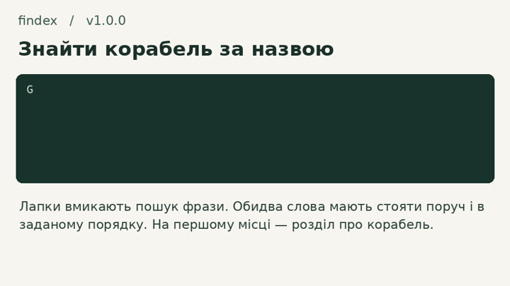
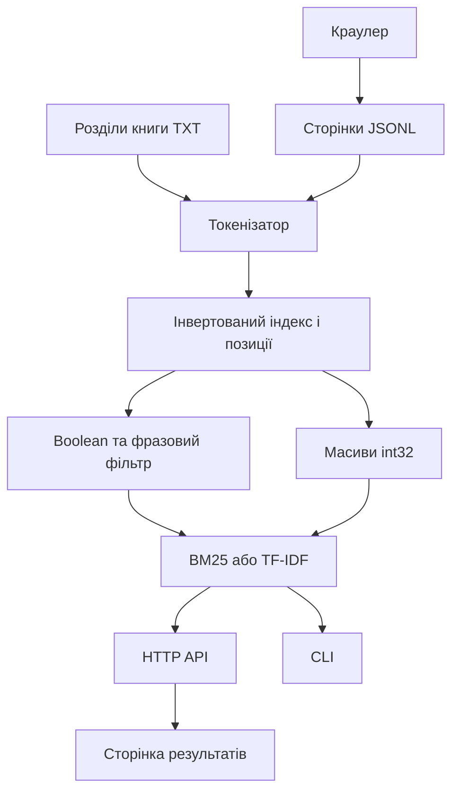

# findex

Пошук по розділах «Війни світів»: введіть слово, фразу в лапках або Boolean-запит, щоб знайти розділ і побачити збіг у контексті.

**[Відкрити вебпошук](https://findex-web.onrender.com)** · [HTTP API](https://findex-web.onrender.com/docs) · [Демонстрація з українськими поясненнями, 2 хв 08 с](docs/demo/findex.mp4)

| Корпус | p95 публічного HTTP-пошуку | Найбільший виграш скорера |
|---|---|---|
| 27 розділів · 60 407 токенів | 10 273 мс на Render, 50 одночасних запитів (замір v0.7.0) | 6,03× для слова the на 270 документах |



## Спробувати локально

```bash
uv sync --locked
uv run python scripts/prepare_data.py
uv run findex index data --positions --out index07.bin
uv run findex pack index07.bin --out packed
PACKED_PATH=packed uv run findex serve
```

Відкрийте http://127.0.0.1:8000 і спробуйте `"thunder child"` або `mars OR earth OR cylinder`. Для командного рядка: `uv run findex search index07.bin 'mars NOT earth' --k 3`. З PACKED_PATH вебзастосунок читає масиви через memmap. Без цієї змінної він створює їх у пам’яті при першому запиті. Docker збирає індекс і відповідний комплект масивів з одного корпусу.



## Вимірювання

[Зведені таблиці лабораторних 1–8](docs/measurements.md) охоплюють пам’ять корпусу та постінгів, якість рейтингу, паралельну індексацію, краулер, HTTP і NumPy. [Профілі та початкові гіпотези](docs/perf/before.md) · [flame graph індексації](docs/perf/index-cli.svg) · [flame graph пошуку](docs/perf/search-cli.svg). Для розгляду гарячого шляху без разового старту CLI: [повторення індексації](docs/perf/index.svg) та [повторення пошуку](docs/perf/search.svg).

## Обмеження

Рейтинг лексичний. Перефразування без спільних термів може не дати результату. Для лаби 8 реалізовано варіант зі стисненням і корпусом ×10. Дублювання розділів з новими doc_id подовжує списки постінгів, але не збільшує різноманітність текстів. Позиції для фраз, метадані та Boolean-фільтр використовують сумісний індекс Python. Розмір стиснених масивів у таблиці стосується лише числової частини. p95 у першому блоці — результат попереднього публічного навантаження; виміри NumPy зроблено локально.

## Перевірка

```bash
uv run ruff check .
uv run pyright
uv run pytest -q
uv run python scripts/bench_lab08.py
```

У CI pytest-benchmark перевіряє пошук і побудову на малому тестовому корпусі. Тести падають при перевищенні граничних медіан 3 та 10 мс відповідно. Це перевірка на суттєве уповільнення; для малих змін варто порівнювати серії на одній машині.
